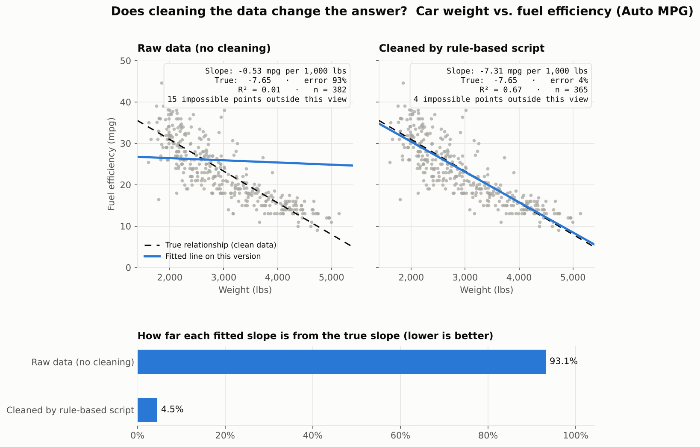

# Data Quality Agent

An AI agent that audits a dataset for quality problems such as missing values, duplicates, impossible numbers, bad dates, and misspelled categories. It writes a report a business user can act on.

Instead of running a fixed list of checks, the agent **decides which checks fit each column, runs them through real Python code, investigates anything suspicious, and judges which findings are actual problems**. A rule-based baseline script runs on the same data so the two can be compared. Both are graded against planted errors with known answers. A regression demo then shows how much each cleaning approach changes a real analysis.



*Car weight vs. fuel efficiency on the Auto MPG dataset with planted typos. Raw data gives a slope 93% off from the truth. After cleaning with the rule-based script, it is 4.5% off. The agent's panel appears once you run the agent (see Quick start).*

## Why an agent?

| Approach | How it works | Weakness |
| --- | --- | --- |
| Script | Runs every rule on every column | Can't tell *unusual* from *wrong*, so it raises false alarms and misses errors a business rule would catch |
| Chatbot | Reads pasted data and guesses | Can't calculate reliably and may invent numbers |
| **Agent** | Chooses checks, calls code to run them, reasons about the results | Costs API calls and needs guardrails, both handled below |

**Core design rule: the code does the counting, and the AI does the reasoning.** Every number in the report comes from a Python function. The model never computes a count itself, so it cannot make one up.

## How it works

```
          goal + dataset description
                     │
                     ▼
   ┌──────────────── Claude (agent) ◄──────────────┐
   │  plans which check to run next                │
   │                                               │
   ▼                                               │
 tool call  ──►  Python check (pandas, read-only) ──► result: counts + examples + finding ID
                                                   │
   log_issue(finding_id, severity, why, fix)  ◄────┘   (rows are attached by code, not the model)
                     │
                     ▼
        finish(summary)  ──►  report.md · issues.csv · flagged_rows.csv · run.json
                     │
                     ▼
   person approves fixes in issues.csv  ──►  apply_fixes()  ──►  cleaned copy for analysis
```

### Agent concepts this project uses

1. **Tools (function calling).** `dq_agent/registry.py` describes 11 tools to the model as JSON schemas. The model requests a tool by name, the code runs it in `dq_agent/tools.py`, and the result goes back to the model.
2. **The agent loop.** `dq_agent/agent.py` repeats plan → call tool → read result until the model calls `finish`.
3. **State and memory.** `AuditState` stores every finding, logged issue, and tool call. Findings get IDs like `F003`, so the model can refer to rows without restating them.
4. **Context management.** Tool results show counts and at most 5 examples, never the whole table. Cost therefore barely depends on dataset size.
5. **Error recovery.** If the model asks for a column that doesn't exist, the error goes back to it as data so it can correct itself instead of crashing.
6. **Guardrails.**
   - **Read-only:** no tool can change the data. The table is fingerprinted with SHA-256 before and after each run to prove nothing changed.
   - **Human in the loop:** the agent only *recommends* fixes. `issues.csv` has an `approved` column, and `apply_fixes(..., approved={...})` applies only the fixes a person approved, always to a copy.
   - **Step limit:** the loop stops after 30 steps to cap cost.
   - **No invented numbers:** `log_issue` takes a finding ID, and the rows are attached by code.
7. **Evaluation.** Errors with an answer key are planted in clean data. Every run is scored on precision and recall, plus how close the cleaned data's regression slope comes to the true slope.

## Test data

### 1. Auto MPG (real data)

The classic [Auto MPG dataset](https://archive.ics.uci.edu/dataset/9/auto+mpg) (UCI, CC BY 4.0) has 392 cars after removing 6 with unknown horsepower. Heavier cars get fewer miles per gallon (r = −0.83, slope −7.65 mpg per 1,000 lbs). The published data serves as ground truth, and `dq_agent/mpg_data.py` plants realistic data-entry mistakes:

| Mistake | Example | Planted |
| --- | --- | ---: |
| Weight typed with an extra zero | 3,504 → 35,040 lbs | 6 |
| Weight entered in kilograms | 3,504 lbs → 1,589 | 6 |
| MPG decimal slip | 24.5 → 245 | 5 |
| Blank / `N/A` / `?` values | mpg, weight, horsepower | 16 |
| Numbers typed with units | `3,504` or `3504 lbs` | 8 |
| Inconsistent labels | `USA`, `U.S.A.`, `japan ` | 15 |
| Car entered twice | exact copy | 16 rows |

The kilogram entries are the hard case. They land between 828 and 1,794 here, low but not far enough from real cars for a statistical outlier rule to notice. Only a business rule ("a car weighs at least 1,500 lbs") catches most of them.

### 2. Mailroom package log (synthetic)

`dq_agent/dataset.py` generates 3,035 fake packages with 240 planted errors of 9 types: bad date formats, future dates, packages picked up before arrival, reused IDs, and more. It also includes **decoys that look wrong but aren't**. Packages still waiting have no pickup date, and a few heavy packages are statistical outliers but realistic. A good auditor should leave these alone.

## Results

| Dataset | Auditor | Caught | Recall | False alarms | Precision | Regression slope error |
| --- | --- | ---: | ---: | ---: | ---: | ---: |
| Auto MPG | No cleaning | — | — | — | — | 93.1% |
| Auto MPG | Baseline script | 66 / 72 | 92% | 0 | 100% | 4.5% |
| Auto MPG | AI agent | *run it* | | | | |
| Package log | Baseline script | 227 / 240 | 95% | 197 | 54% | — |
| Package log | AI agent | *run it* | | | | |

Where the script falls short:
- **Auto MPG:** it misses all 6 kilogram weights, because its outlier rule only flags values far from the rest. Adding a weight rule of 1,500–6,000 lbs, which is the kind of domain knowledge the agent is told to use, catches 4 of them and cuts the slope error from 4.5% to 2.5%. Two kilogram entries (1,601 and 1,794) look like real light cars and slip past both.
- **Package log:** it flags 192 blank pickup dates that are expected, and its outlier rule misses 13 of 20 impossible weights.

Fill in the agent rows with your own run, and only report numbers you actually got.

## Quick start

```bash
pip install -r requirements.txt

# 1. Make the test data and answer keys (Auto MPG + package log)
python scripts/make_dataset.py

# 2. Rule-based baseline (no API key needed)
python scripts/run_audit.py data/mpg_messy.csv --mode baseline

# 3. AI agent (needs an API key from console.anthropic.com; billed per run)
export ANTHROPIC_API_KEY=your-key-here
python scripts/run_audit.py data/mpg_messy.csv --mode agent
#    cheaper while experimenting:  export DQ_AGENT_MODEL=claude-haiku-5-5

# 4. Score both against the answer key
python scripts/evaluate.py outputs/mpg_baseline/run.json outputs/mpg_agent/run.json

# 5. Regression chart: raw vs. script-cleaned vs. agent-cleaned
python scripts/regression_demo.py        # -> outputs/regression_comparison.png

# Tests (no API key; the agent loop is tested with a fake client)
pytest
```

The same commands work for the package log (`data/package_log_messy.csv`). To audit your own CSV, describe what the data represents so the agent can use business sense:

```bash
python scripts/run_audit.py my_data.csv --mode agent \
  --description "Monthly sales by store. order_id must be unique. quantity is 1-500."
```

## Project layout

```
dq_agent/
  tools.py      read-only check functions + AuditState (the agent's memory)
  registry.py   tool schemas for the model + dispatcher
  agent.py      the agent loop and system prompt
  baseline.py   rule-based script for comparison
  fixes.py      apply approved fixes to a copy of the data
  report.py     report.md, issues.csv, flagged_rows.csv, run.json
  mpg_data.py   Auto MPG with planted errors (real data)
  dataset.py    synthetic package log with planted errors
  evaluate.py   precision / recall scoring
scripts/        make_dataset · run_audit · evaluate · regression_demo
tests/          22 tests, including an end-to-end loop test with a fake API client
data/source/    original Auto MPG file
```

## Talking points

- **What it is:** "An agent that audits datasets. It picks the right checks, runs them as Python functions, digs deeper when something looks off, and writes a prioritized report with suggested fixes."
- **Why data quality matters:** "On Auto MPG, a few typos turned a strong relationship (R² 0.69) into almost nothing (R² 0.01). The fitted slope was 93% wrong. After cleaning, it was within a few percent."
- **Why not a script:** "A script can't tell unusual from wrong. It missed weights entered in kilograms because they look like small cars, and on the package log it raised 192 false alarms. The agent can apply business rules and reason about what the data means."
- **How I prevented hallucination:** "The model never calculates anything. Every count comes from code, and issues reference finding IDs whose rows the code attaches."
- **Safety:** "It's read-only, verified with a fingerprint. A person approves every fix before it's applied to a copy, and a step limit caps cost."
- **How I know it works:** "I planted errors with an answer key, measured precision and recall, and checked how close each cleaned dataset's regression came to the true slope."
- **Where a client would use it:** Before a system migration, before building a dashboard, or as a recurring data-quality monitor.

## Ideas to extend it

- Streamlit web page to upload a CSV, review issues, tick "approve," and download the cleaned file
- Run the agent several times and report how consistent its choices are
- Cross-field rules, e.g. "status is Picked Up ⇒ pickup_date is required" or "4-cylinder cars rarely weigh 4,500 lbs"
